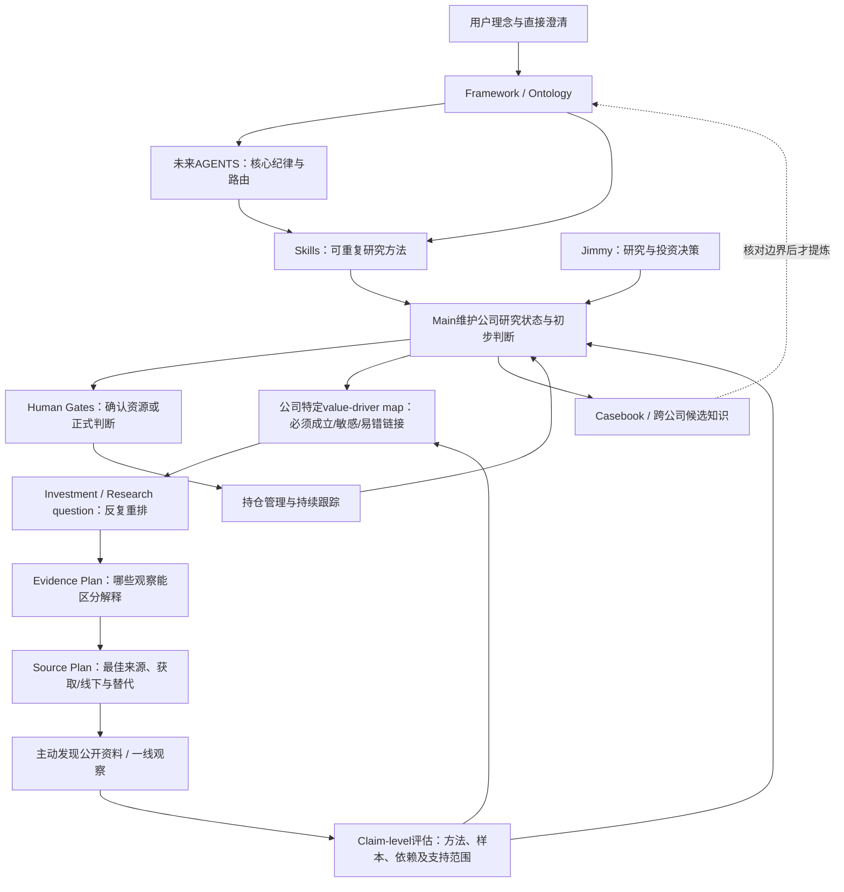

# Architecture Alignment Report

更新日期：2026-10-31。版本：M023立项 / Question Generation修订稿。原设计见[M014](framework/materials/M014-2026-10-30-architecture-design-request.md)，已对齐人机边界见[M016](framework/materials/M016-2026-10-31-architecture-feedback.md)，Source/Evidence要求见[M022](framework/materials/M022-2026-10-31-source-evidence-design.md)，本轮两项核心能力要求见[M023](framework/materials/M023-2026-10-31-initiation-question-generation.md)。整体架构方向已获基本认可；本轮从五份真实立项提炼candidate-screen，强化独立Research Planning的driver map→主动问题→三轴排序/循环，并实际开展早期材料回放；有限首轮不等于稳定性已验证。M022覆盖/冲突见[Source & Evidence报告](source-and-evidence-architecture-change-report.md)，本轮落实/测试及剩余缺口见[立项与问题生成报告](initiation-and-question-generation-change-report.md)。

[M015反馈](framework/materials/M015-2026-10-30-thesis-status-labels.md)的三种thesis状态继续采用：“待审阅”“继续验证”“已确认”。M016进一步明确实质性变化确认、formal state与current actionability分开，以及research/capital attractiveness分别维护。

本报告区分“已明确的投资方法”“用户规定的人机分工”“实现设计”与“实际验证”。**最终AGENTS.md继续暂缓，旧候选不采用。先更新预期并开展behavioral eval，保留实际回答、偏差及未覆盖边界，再决定哪些核心纪律进入AGENTS。** 评估方法和结果见第9节。

## 1. Harness最终解决什么问题

让Jimmy与AI长期共同研究少数值得理解的公司：从信息中辨认生意和竞争机制，尽可能清楚地判断未来大致能创造多少FCF、以什么价格和风险获得回报，并持续检验、修正判断。系统要保留为什么这样判断、哪些仍未知、哪些已由Jimmy确认，以及新证据怎样影响旧判断。

Main Investment Research Agent是持续维护研究状态的Copilot。它可以整理资料、提出假设、分析、建模、给建议和协调独立审阅；**最终投资判断由Jimmy作出**。研究扎实后形成Reject、Too Hard、继续研究或买入建议，都是有效产出。

第一版以可读Markdown、少量JSON清单、必要计算和Git为基础。知识层、研究阶段和人员职责先设计清楚，不以数据库、网页、全自动Agent系统或更多模板作为完成标准。

### 当前实际状态

| 部分 | 已有 | 尚未落地 |
| --- | --- | --- |
| Philosophy / ontology | 长篇框架、24条B观点、33个C概念、M012/M013的12项反馈 | 不能据此称所有公司事实、案例归纳或未来判断已确认 |
| AGENTS | 生效的临时整理约定；另有前轮17条候选 | 最终版未生成，本轮暂停采用旧候选 |
| Skills | 8个Markdown方法入口；M022新增research-planning并修订6个既有Skill，valuation仍保留通用草稿地位 | 不是Agent执行平台，工作方法仍须实际行为验证 |
| 公司研究 | 轻量research cockpit、thesis/evidence/valuation模板；已有多公司casebook及Kaspi历史测试 | 尚无真实公司正式工作档案或已确认的当前投资thesis/估值，模板不是研究成果 |
| 组合 | 3份空JSON | 未录入真实持仓/现金；空清单不等于实际空仓 |
| Evals | 文件检查、原15类实际Main试运行及Kaspi续轮；现29类预期，并新增立项/HQG早期材料实际回放 | BE16–24未逐题运行；历史资料/参考有限，共享FS非技术隔离，稳定性和真实完整Main路径仍待验证 |
| 版本管理 | Git在main、材料原件与历史快照已保存 | 本地尚无Git提交，不能把快照称为已形成Git/GitHub提交历史 |

## 2. Philosophy layer：已对齐内容、开放问题与张力

完整含义以[长篇框架](framework/long-form-investment-framework.md)、[ontology](investment-ontology.md)和原始理念/后续直接澄清为依据。本轮不修改原始理念文件，不重新发明一套原则。

| 核心内容 | 已明确的决策含义 |
| --- | --- |
| 价值与FCF | 未来FCF折现为锚，落实每股价值与股东所得；理解增长再投入对表观报表的影响，不一概加回。可不精算DCF，但须懂其理念 |
| 极少数最好机会 | “20个击球机会”是高标准，不限次数；风险收益相近时研究优先长期优秀企业，研究优先与资金配置分开 |
| normal value | 也需懂业务、明确竞争优势/护城河、无红线、可估未来FCF及较好IRR；主要可能少长期再投资跑道 |
| 生意与护城河 | 同时解释用户价值、未来现金创造和竞争防御；经济结果可在未来，经常性/维持成本按经济实质理解 |
| 管理与资本配置 | 论迹不论心；实锤红线不被持股抵消。其他风险/警惕合并；治理关键背景实质变化可回风险中性，仍查改善/监控/纠正 |
| 理解和证据 | 理解先于IRR比较，主要FCF对未知更低容忍；自身已知、直接前瞻推导、跨国/行业类比有不同置信度依据，调研修偏差、类比检验前提 |
| 研究与thesis | 相对标准立项→FCF关键问题→初步研究→重要问题深入；少数简单thesis需充分论证。过程中可正常Reject/Too Hard |
| 估值和下行 | 各情景IRR加权；谨慎合理倍数修复；EPV/可信成长/option分层；reverse IRR反看价格要求。主要持仓极端情况下避免显著永久损失，不设通用0 IRR硬线 |
| 持有、现金和机会成本 | Thesis改变按未来FCF及可估计性重审；现金永远比较，结合当时组合。允许Hold but don't add，不把新增买入门槛机械变成卖出线，也不保证15%必然持有。尾部小仓位不能补不懂 |
| A/B/C/D | 研究资源、内容、深度的分配，A为持有跟踪，非质量排名 |

### 2.1 Open questions核对

[open-questions](framework/open-questions.md)的T001–T007、U001–U017编号继续保留。**未发现需要重新回答、且会阻止本次架构设计的核心理念问题。** M012/M013已经覆盖12个主题，不要求Jimmy重答。

以下仍需研究，但不是全局方法未对齐：某公司的增长/维持投入比例、未来费用与回报周期、TAM与份额、情景权重、极端事件、合理终值、反证是否坐实、能力圈类比前提，以及具体仓位/现金取舍。U008的研究流转、U012–U016涉及的机制和参数也不需先写成统一公式。

T006旧三分标题已在M014按M012更正为红线与合并风险/警惕；原话保留。本轮不再将已修正的旧展示问题列为当前缺口。M016对操作边界的回答见第10节，不重开已回答的哲学问题。

### 2.2 仍保留的张力及处理方式

| 张力 | 当前已有处理 | 仍不能替Jimmy决定的部分 |
| --- | --- | --- |
| 长期优秀企业与高回报normal value | 合理投资范围与研究资源优先分开 | 当时具体资本/时间怎样取舍，不设固定比例 |
| 集中核心与极端尾部小仓位 | 不同策略条件；尾部要理解分布/事件/时间，小仓位控制组合影响 | 不自动建立未来专门资金池或放宽理解条件 |
| 必须预测与对主要FCF未知低容忍 | 收集直接信息、修正偏差、论证类比前提；不可方向判断则Too Hard | 某项证据是否足以支持投资，需要个案论证 |
| 成长投入压低报表与美化现金流的风险 | 拆维持/增长、研究投入回报，不一概加回 | 哪项支出真实可省、成熟期费用会否下降 |
| 长期持有、forward IRR下降与现金选择 | 允许Hold but don't add；比较剩余现金流、理解、风险和当时组合，不按新买入门槛自动卖 | 哪些条件下保留、减少或替换，不能固化成两条永久IRR线 |
| 研究中的反证与已确认thesis | 保留最后确认的formal thesis；新重大证据待复核时单独标记行动限制，不自动新增资本 | 证据何时足以改变正式判断，仍需研究与Jimmy的实质性决定，见D3 |

谨慎合理修复与“不要依赖乐观估值”、不精算DCF与FCF折现锚、当前利润未释放与未来好生意、红线与治理翻篇等，已通过适用条件/时间阶段解释；不再冒称尚未解决的矛盾。上表的张力也不因已有处理方向就消失。

## 3. Knowledge layer：信息如何成为知识和判断

### 3.1 六类知识与authority/provenance

| 层 | 保存什么 | Authority与限制 | Provenance与位置 |
| --- | --- | --- | --- |
| Raw source material | 原理念、原财报、历史研究、原始聊天/片段、管理层发言、网页、访谈原文 | 保真记录“材料写了什么”；原始并不等于内容真实。聊天里AI的话不自动是用户观点 | 作者/说话者、日期/观察期、原件位置、截断/转写限制。既有材料留在framework/materials，后续公司原件可在公司evidence中保存或引用 |
| Processed evidence | 核对后的事实、口径、摘录、矛盾、未核声明、派生计算 | 支持分析，不等于投资结论；“管理层曾预测”与“预测已经实现”分开 | 原件定位、加工者、核实程度、推导/单位/期间、支持或挑战什么；公司evidence/index.md及必要摘录 |
| Company-specific knowledge | 公司如何赚钱、经营驱动、历史、关键未知与研究/资本吸引力 | 事实、机制推断与投资判断分开；research.md是cockpit，不是第二份完整报告或thesis | 简要current understanding、业务特定value-driver map及Question/Evidence/Source Plan在research.md，细节链接evidence/分析材料；M022已新增轻量模板 |
| Thesis / valuation / research state | 少数投资判断、现金流/估值假设、研究阶段、问题优先级、审阅/确认与决策记录 | 分初步与Jimmy确认的版本；确认是治理状态，不是真理证明或交易完成 | thesis.md、valuation.md、research.md、updates；记录作者、依赖证据、版本和确认 |
| Cross-company reusable knowledge | 行业机制、竞争范式、跨国对标、可复用案例、适用前提与反例 | 候选经验或有证据的领域知识，不自动上升为投资哲学 | casebook保留真实过程；重复使用的主题再提炼为knowledge中的少量Markdown，链接多个来源，不先建百科目录 |
| Framework / philosophy | Jimmy明确表达的一般理念、定义、decision rules、证据/判断纪律及未解张力 | 方法规范以用户最新相关直接说明为准；不能用这条优先级覆盖外部事实真伪 | 原理念/澄清→长篇framework/ontology→未来AGENTS的精炼与路由；案例归纳单独标候选 |

Authority必须区分两条轴：**谁有权决定正式投资状态**，和**某条事实/推断有多可信**。Jimmy确认一个thesis，使它成为认可的判断版本；它仍须接受新反证。反过来，一条真实财报数据也不会自动成为投资thesis。

### 3.2 Source/evidence到thesis，不自动跳级

Investment question→Research question→Evidence Plan→Source Plan→主动取得原始资料→claim-level评估/依赖核对→公司理解/假设→分析论证、反例与现金流影响→初步thesis→Jimmy对实质判断审阅/确认。资料不自动升级，重复来源不增加独立支持；详见[Source & Evidence Policy](framework/source-and-evidence-policy.md)。

AI、Jimmy、共同讨论都可以形成初步thesis。作者和确认状态独立记录；不能因为出自Jimmy一段探索性发言、GPT摘要写“用户认为”、或一份报告存在，就自动标“Jimmy已确认”。

Thesis版本使用以下三个状态：

| 状态 | 含义 |
| --- | --- |
| 待审阅 | 已有分析/初步thesis，等待Jimmy审阅 |
| 继续验证 | 仍需补充证据、研究或调整，尚未确认；状态本身不代表Jimmy已审阅或认可 |
| 已确认 | Jimmy已明确认可相应判断，记录日期与所确认内容；后续实质性修订不自动继承确认。排版、链接及不改变判断的修正无需逐文件版本重新确认 |

**Material Evidence Under Review**作为独立提示附在研究cockpit：记录新证据、核实程度、可能影响的thesis及FCF路径、复核动作与当前行动限制。它不是第四种thesis确认状态，也不使最后确认的formal thesis自动失效。Formal state与current actionability分开维护；未复核前不沿用旧结论自动建议新增资本，不因一条未核实反证改thesis、卖出或改变实际持仓。

Jimmy不需要填写版本号或维护表格；Main根据讨论上下文记录确认针对哪些判断/假设及相应版本，有关键歧义才澄清。“看过了”不自动等于“同意”，共同讨论过也不自动等于已经确认。

没有确认记录时，先标明记录缺口并查现有材料；不能从已持有、研究阶段或GPT摘要反推“已确认”，也不为填满三种状态而猜一个。查已有记录优先于要求Jimmy重复确认。这一边界来自本轮BE15实际回答暴露的偏差及定向修正。

### 3.3 谁可以写什么

| 内容 | Main Agent | Subagent | Jimmy |
| --- | --- | --- | --- |
| 原始资料 | 保留原件、追加新版本和定位 | 在任务提供的范围阅读，提交发现 | 提供材料/说明范围；不要求学习文件格式 |
| Evidence与工作底稿 | 可整理、核实、标注争议并推进工作分析 | 默认返回独立报告，由Main归档；报告内事实仍需核验 | 可补充、更正来源或质疑解释 |
| 初步thesis/工作估值 | 可生成清楚标未确认的草稿和修订建议 | 可挑战/提出替代观点，不直接改当前thesis/valuation | 可提出自己的判断，与Main共同修订 |
| Jimmy已确认的正式判断 | 非实质性维护可自主完成并留痕；可能改变核心thesis、估值判断、Pool、资本配置或正式投资结论时，提交差异与影响，按Jimmy决定更新 | 默认无直接写权限 | 确认material / decision-relevant change，无需逐文件版本或逐项小假设批准 |
| 组合建议/计划 | 分析回报/风险/现金和给建议，不当作成交 | 提供独立风险/估值意见 | 决定投资与仓位 |
| 实际portfolio | 仅据用户提供/确认的真实交易或持仓事实记录 | 默认不修改 | 确认实际状态；批准建议不等于交易已执行 |

确认对象是**实质性判断变化，不是每次文件保存**。Main自主更新evidence、工作模型、机械计算和非实质性假设，记录来源和差异；如计算修正虽然机械，却可能改变估值判断或资金决定，也应提交实质性确认。不能将许多小改动累积成重大变化后仍称“非实质”；比较最后确认基准和累计影响，不设通用百分比审批线。

Thesis判断、估值判断、资本决定和已发生交易仍不能互相代替。Jimmy一次明确讨论可以确认一组相关实质变化，不必为每个文件/假设逐条操作。Main按语义记录范围，只有关键歧义才澄清。

### 3.4 最小物理结构设计

沿用目录，M022已在公司模板落实一份research.md，实际公司档案仍按需初始化：

```text
framework/                     长篇方法、原始理念与对齐记录
investment-ontology.md          定义和关系
companies/<company_id>/
  research.md                  轻量cockpit：阶段、理解、Question / Evidence Plan / Source Plan及下一步
  thesis.md                    少数初步/已确认判断，明确版本状态
  valuation.md                 输入、假设、EPV/成长、IRR及反向检查
  evidence/index.md            加工证据与原件定位
  updates/                     变化、Jimmy决定、独立审阅报告
casebook/                      真实判断过程与有边界的候选经验
knowledge/                     按实际跨公司主题出现再建立，不预建分类树
portfolio/                     现有3份JSON：真实持仓、watchlist、candidate box
skills/                        8个方法入口；research-planning独立且反复调用
evals/                         文件检查、行为预期与之后的实际评估记录
scripts/                       确有复算需求才添加计算
```

Jimmy已同意新增research.md，定位为**research cockpit**。M022已落实轻量模板，尚未初始化真实公司的文件。它只维护导航和研究工作状态，不复制完整报告或少数核心thesis。更简单方案是放在thesis末尾，但会混淆探索过程与正式判断，因此实际公司试用时增加这一份轻量工作文件即可。

Cockpit主要维护：current research stage、简要current understanding、prioritized research questions、highest-value unknown、resolved questions（结论/证据链接及必要的重开条件）、evidence gaps、disagreements、offline research needed、next best research action、material evidence under review。问题条目沿用第4.3节的research-planning信息；正文只写一处，详细论证以链接引用。

另外显式显示research attractiveness与capital attractiveness、A/B/C/D pool、portfolio status、当前formal thesis/valuation链接与actionability。显示不等于重复维护：实际持仓来自portfolio事实，thesis来自thesis.md，问题与研究阶段由cockpit维护。

避免重复维护：研究阶段/问题以research.md为入口；当前thesis及其版本确认在thesis.md，当前估值及其假设/确认在valuation.md，实际组合在portfolio清单。research.md只引用这些版本和待决事项，不另存一套当前thesis/估值正文；updates保留变化和确认事件。

Timee原件不搬家、不重复复制；未来公司证据链接既有M010/M011定位即可。casebook不维护第二套当前thesis。M011的事件JSONL是案例审阅辅助，不扩成全局图数据库。

### 3.5 Research attractiveness与Capital attractiveness

两者在company research state和candidate comparison中分别出现，不只保留一句理念，也不合成一个总分：

| 维度 | 要回答的问题 | 最小记录 |
| --- | --- | --- |
| Research attractiveness | 是否值得持续投入认知与研究资源，能否学到足以改变判断的内容？ | 长期潜力/知识复利、ability to learn、关键证据可得/可验证性、继续研究的信息价值及成本/时间、最高价值未知与下一动作 |
| Capital attractiveness | 在当前价格和信息下是否值得投入资本？ | 价格/日期与估值版本、理解/置信度依据、预期回报与下行、现金/组合比较，以及buy/add/hold/wait等工作建议和限制 |

候选比较至少把这两列、理解缺口和下一步动作并排呈现，标明判断截至日期与依据。优秀compounder可以研究吸引力高、当前资本吸引力低；易理解、低下行且约25%IRR的normal value可以当前资本吸引力高，但长期新增研究投入有限。公司类型不是任一吸引力的替代标签，capital也不按IRR一个数排名。

研究吸引力高不表示无限投入时间：已有重要问题已解时，可以低频积累、等待高价值新问题；关键FCF driver长期难获证据/不可验证时，降低研究吸引力，必要时Too Hard。一次未找到或工具访问受限不等于客观永久不可知。资本吸引力高也不能跳过必要理解或决策gate。研究投入变化可由Main在授权范围内排序；可能改变正式Pool/资本决定时按D1处理。

### 3.6 三种状态分开，关联约束保留

| 字段 | 表示什么 | 不表示什么 |
| --- | --- | --- |
| Research stage | Idea、立项、Planning、初研、深研、持仓管理、跟踪等当前工作阶段；可以返回先前阶段 | 不是质量、是否已持有或thesis是否确认 |
| A/B/C/D pool | 已明确的研究资源、内容与深度分配；A为持有并跟踪 | 不是公司好坏、生命周期进度或一笔成交记录 |
| Portfolio status | 真实投资状态，如未知、未持有、已持有、已退出；只据Jimmy提供/确认的事实 | 不是推荐/拟买入，也不能从深研、Pool或thesis确认反推成交 |

三者分字段不意味着彼此毫无约束：真实已持有并跟踪按既有A定义记录，但一家公司重新进入初研/深研不使持仓自动消失；“准备重要买入”不等于已持有，也不应提前写成A。B/C/D沿用已表达含义，资料不足时保持未知，不新造质量排序。Watchlist/candidate-box/holdings三个文件也不直接等同三个Pool。Thesis三种确认状态与Material Evidence Under Review另列，不用任何一个字段代替其余状态。

### 3.7 研究闭环



图表示职责设计，不表示Skills、Human Gates或自动执行已实现。原件保真、证据核实、分析质量、Jimmy确认是四种不同状态。

### 3.8 Source Discovery与Evidence Policy

[Source & Evidence Policy](framework/source-and-evidence-policy.md)是详细规范，[evidence-standards](framework/evidence-standards.md)保留编号/日期入口。Main负责Question/Evidence/Source Planning、主动公开发现及证据综合，不能只等待Jimmy提供材料。

来源的authority只覆盖适合的claim：正式披露通常优先建立历史数字和法律事实；管理层TAM/增长/粘性仍是claim。Policy给A–H default priors而非排名，按Proximity、Authority、Incentive、Methodology、Sample/Representativeness、Independence、Recency、Relevance、External validity、Falsifiability推理，无总分。区分“可靠记录谁说过”与“足以证明现实”。

Source count ≠ Evidence count；识别共同原话/采访/数据/模型和循环引用。基金/VIC/long-short研究单列高价值analytical secondary；重要claim追原件/独立核查。论文方法质量与迁移前提分开；访谈按角色、覆盖、业务量、样本/招募和利益评估，不能按来源名头覆盖真实行为证据。

证据综合需说明原belief/替代解释、新证据及依赖、区分什么解释、经营机制/FCF和confidence为何变或不变、剩余未知。正式判断与actionability仍按D1/D3，不因增加证据条目自动确认/修改thesis。工具访问限制、未读资料和线下任务计划如实记录，不伪装已采集；适时将需要亲历的关键问题交Jimmy。

## 4. Investment Research Lifecycle

所有阶段以未来FCF理解和决策价值为导向。阶段产出可以是一段清楚记录，不要求每阶段新建模板。Reject、Too Hard、观察/等价格、补资料都可以形成分支；不要求一路走到持仓。

### 4.1 Idea Generation

| 字段 | 定义 |
| --- | --- |
| Goal | 找值得投入研究资源的线索，同时积累有复利的认知 |
| Input | Jimmy兴趣、优秀行业/同行、历史案例、事件或价格/经营变化等来源 |
| AI responsibilities | 发现异常/机会并解释研究价值，主动找初步primary source核身份/基础信息；以lead为主，不全面搜索或只列便宜股票 |
| Jimmy responsibilities | 提出关注方向，调整研究优先和现实约束 |
| Required output | 简短机会线索、值得研究的原因、关键疑问及下一步建议 |
| Exit / decision gate | 进入立项、留雷达/观察、Reject或Too Hard；常规整理不新增一道强制审批 |

### 4.2 立项

| 字段 | 定义 |
| --- | --- |
| Goal | 相对标准地建立基础覆盖，判断是否值得进一步了解 |
| Input | 公司/证券身份、可得公开材料、现有框架和初始问题 |
| AI responsibilities | 主动取得适用时点年季报、相关招股书、presentation/call、官方经营数据、治理/股东、回购分红、监管、主要对手原件与基础行业数据，少量高质量第三方；建立客户/产业链/竞争/unit economics/增长/治理/FCF的business skeleton，不堆二手报告 |
| Jimmy responsibilities | 补充已知背景、重要雷点或优先问题；无需替AI填写表格 |
| Required output | 可读立项报告，建立business/value chain/traits/moat、TAM/competition/量价/利润FCF、management/governance/allocation、valuation snapshot、risks/unknowns、key questions及Reject/Too Hard/Proceed；按业务合并组织，非固定填表。附driver map与下一步 |
| Exit / decision gate | 有理由继续到Research Planning，或基于扎实分析Reject/Too Hard/观察；立项通过不等于投资通过 |

### 4.3 Research Planning

| 字段 | 定义 |
| --- | --- |
| Goal | 在Jimmy未提供具体问题时也能从业务主动识别关键未知，持续把有限研究资源投向最影响长期FCF/价值/决定且可学的少数问题 |
| Input | 立项/初研/深研/跟踪任一阶段的新结果、current belief、已解问题、证据缺口与研究条件 |
| AI responsibilities | 独立调用research-planning，形成Question → Evidence Plan → Source Plan；按信息价值及ability to learn选最高价值未知和next best action，在已确认范围自主选公开来源、方法、工具及有边界临时任务；及时准备Jimmy线下brief |
| Jimmy responsibilities | 调整关注重点、可用的一线资源和研究投入；可补关键假设 |
| Required output | 在research cockpit维护优先问题、证据与获取路径、已解决/重开原因、最高价值未知和下一步；不另写一份重复规划报告 |
| Exit / decision gate | 返回当前相应研究阶段，可反复调用；范围/关键前提实质变化才回Jimmy讨论。命脉不可判断可建议观察/Too Hard，不以填满计划为目标 |

**已落实为独立[research-planning Skill](skills/research-planning/SKILL.md)。** 用途是反复选择和更新“下一步最值得知道什么”，deep-dive负责实际论证和研究深度；二者可互相调用，但前者不是后者的一次性前置。更简单方案是同一deep-dive的一节，却容易在跟踪/初研中失去入口，因此落实这一有清楚职责的Skill，不另设常驻Planning Agent或自动规划系统。

M023强化生成前端，详细方法见[立项与问题生成](framework/initiation-and-question-generation.md)：
1. Business understanding → 公司特定value-driver map（量/净价/成本/投入/现金/配置/每股，分业务及优势期限），不套通用树或造Base Case。
2. 对重要节点问must be true、当前未知、最大价值敏感、最可能错及依据、证伪、市场似乎相信什么及同期证据、现实可得区分证据。
3. 变成具体可证伪/可取证、可改变决定的问题，不能只给“趋势/优势/风险”章节问句。
4. 至少三轴分别给理由：decision sensitivity、uncertainty、researchability / expected value of information；无总分，不只查容易的，也不无限研究不可知的。
5. 初研先查准入机制，通过后才做条件深研；每轮记录已解/信心变化/新题，更新map、highest-value unknown及下一单位时间，控制活跃清单。
6. 再对高优先问题制定Evidence/Source Plan；保持M022逻辑信息，不强迫表格。本次历史eval5–10题仅测试规格，不设日常固定条数。

每个重要research question至少考虑以下逻辑信息，用自然语言问题条目，不要求逐字段填表或Jimmy维护：

| 信息 | 要表达什么 |
| --- | --- |
| Question | 可区分、可影响判断的问题 |
| Why decision-relevant | 为什么答案改变研究/价值/资本判断 |
| Which FCF driver | 量价、优势持续、利润/现金转化、维持/增长投入、资本配置、时间或可估计性 |
| Current belief | 当前理解及依据，不知就明示 |
| Current uncertainty | 信息、推导、类比或结果不可知的缺口 |
| Strengthen evidence | 什么观察会加强，支持到哪层 |
| Weaken evidence | 什么观察会削弱，替代解释是什么 |
| Falsify evidence | 什么会证伪，能否实际获得/观察 |
| Best source types | 针对所需观察选来源，不按全局排名 |
| Currently available sources | 已有证据/定位及争议，具体可查原件/数据 |
| Primary-source availability | 能否取得原始披露/数据/亲历者，实际访问限制 |
| Alternative evidence | 理想资料不可得时的proxy、访谈/调查、可比及迁移限制，或保留unknown |
| Public research | 公开能答哪层，未找到不等于未披露/不可知 |
| Offline research | 哪个剩余机制需亲历、找谁/观察什么、中性问题和偏差，及时交Jimmy |
| Research priority | 相对顺序、最高价值未知及重排理由，不机械总分 |
| Expected value of further research | 哪类答案会改变决定、能否学到、成本/时间是否值得；继续/等待/转线下/结束条件 |

Source Plan包含具体寻找/收集动作；取得后交evidence-update做claim-level评估与综合。线下brief不必等穷尽全部公开报告；没有理想数据不靠低质量材料填confidence。对已知事实不重问，已充分解决的问题不为流程增工作。

初研、深研和monitoring每次出现足以改变未知排序的信息时都可重排；已解问题保留简短结论和来源，证据/前提变了可以重开。Highest-value unknown不必是最容易查的问题，资料数量和季度噪声也不自动决定优先级。

已有证据充分解决的问题不为流程再做一轮。新增研究任务必须说明具体缺口及决策价值；不能笼统用“继续核查”拖延可进入资本讨论的机会。这也是首轮BE11表述偏差的修正，不取消D4触发的独立Red Team。

### 4.4 初步研究

| 字段 | 定义 |
| --- | --- |
| Goal | 初步回答关键问题，形成有依据的FCF机制与初步thesis |
| Input | 研究计划、原始材料、直接信息、适用的对标和已处理证据 |
| AI responsibilities | 从公司叙事转向机制实证，按问题增加对手/上下游、行业数据、论文、优质投资人/券商分析、客户/员工/供应商、监管历史和comparables；核方法/依赖/迁移，形成FCF机制，按需初估不造精确IRR |
| Jimmy responsibilities | 质疑解释、补调研信息和自己的判断，与Main讨论 |
| Required output | 初步thesis/估值状态、证据与反证、置信度依据、仍需深入的关键问题；thesis版本按“待审阅”“继续验证”“已确认”记录 |
| Exit / decision gate | 提交Human Decision Gate 1；也可提前提出Reject/Too Hard，不为形成买入建议继续堆资料 |

### 4.5 Human Decision Gate 1

| 字段 | 定义 |
| --- | --- |
| Goal | 由Jimmy决定是否值得投入深度研究，以及研究范围 |
| Input | 初步研究、初步thesis、关键证据/反证、未知及拟深入计划 |
| AI responsibilities | 综合已知/未知，解释继续研究的价值、风险与最重要问题，给出建议 |
| Jimmy responsibilities | 决定深入、补初研/资料、观察、Reject或Too Hard；指定优先范围 |
| Required output | Jimmy决定及研究授权范围、仍需验证的关键点 |
| Exit / decision gate | 获准后进入深度研究；**通过此gate是研究资源决定，不自动确认全部thesis或授权买入** |

### 4.6 深度研究

| 字段 | 定义 |
| --- | --- |
| Goal | 对更重要的问题深入，使未来大致FCF及其价值尽可能清楚 |
| Input | Gate 1范围、关键问题、可得证据、一线研究/可比资料和工作模型 |
| AI responsibilities | 围绕unresolved key questions定义区分证据与最适来源，不默认堆报告；例如网络效应看双边multi-homing、fill rate/density、留存/竞争/地域/切换，再选访谈、行为数据或论文。反复Planning和证据综合，减少决策相关未知；有依据才形成FCF情景/IRR。按D4默认Red Team，Auditor/Valuation Reviewer按需，保留分歧 |
| Jimmy responsibilities | 提供判断、质疑主要前提、协助仅凭公开资料无法获得的信息；不要求亲自完成全部数据工作 |
| Required output | 可评估的研究结论、thesis候选、估值/风险/机会成本、独立审阅及剩余未知；或有依据的Reject/Too Hard |
| Exit / decision gate | 进入Human Decision Gate 2；研究中可停止，不必等所有章节完成 |

### 4.7 Human Decision Gate 2

| 字段 | 定义 |
| --- | --- |
| Goal | 由Jimmy完成投资判断，确认material / decision-relevant的正式变化 |
| Input | 深研结论、thesis/估值候选、重要反证、独立报告、与现金/现有组合比较 |
| AI responsibilities | 清楚呈现建议、依据、分歧、情景限制，以及旧正式版本拟改什么 |
| Jimmy responsibilities | 决定核心thesis、估值判断、Pool、资本配置及正式投资结论的实质变化；不逐项批准每个文件版本/非实质假设 |
| Required output | 版本明确的确认或保留意见、投资决定/计划及理由；thesis确认不必然伴随买入 |
| Exit / decision gate | 有投资/已有持仓进入Position Management；也可留优质候选、观察或终止。批准买入建议不等于已成交 |

### 4.8 Position Management

| 字段 | 定义 |
| --- | --- |
| Goal | 结合剩余回报、永久损失、现金等待价值及整体组合配置资本 |
| Input | Jimmy投资判断、可靠估值、实际已知持仓/现金、替代机会和风险 |
| AI responsibilities | 分开评估buy/add与hold/reduce/exit，允许Hold but don't add；比较剩余FCF、回报、永久损失、现金/替代及组合，区分建议、计划和实际状态 |
| Jimmy responsibilities | 最终决定仓位与实际交易，并提供/确认已发生事实 |
| Required output | 有理由的持仓建议/决定记录；实际portfolio仅按真实确认记录更新 |
| Exit / decision gate | 持续跟踪；重要新信息或机会成本变化可回研究/决策gate。Harness不自动执行交易 |

### 4.9 Ongoing Monitoring

| 字段 | 定义 |
| --- | --- |
| Goal | Thesis-driven monitoring：持续检验少数核心判断及长期FCF，而非按新闻数量决定研究工作 |
| Input | Thesis中的支持/削弱/证伪路径及监测项；新闻、财报、访谈、竞争/监管信息和价格只是evidence inputs |
| AI responsibilities | 将新证据映射到具体thesis/FCF，区分暂时/结构变化；重要未知调用research-planning。标Material Evidence Under Review及actionability，保留最后正式判断 |
| Jimmy responsibilities | 对重要分歧、核心判断/估值变化和持仓建议作决定 |
| Required output | 新证据支持/削弱/可能证伪哪条thesis、FCF影响与核实程度、下一步动作；无关联材料可只归档。实质变化汇总给Jimmy，不为每条新闻新建报告 |
| Exit / decision gate | 小变化继续；重要未知回Planning/初研，新增深研范围按Gate 1；实质正式判断/资本决定按Gate 2。季度beat/miss不是默认目标 |

核心thesis应尽量记录what strengthens it、what weakens it、what could falsify it、what should be monitored、which source is best suited for monitoring it，连到证据和研究问题。这些条件围绕经营机制及FCF，不为整齐而杜撰可证伪的数字阈值。Price本身不能替代基本面证据。

已研究公司收到新资料不必重走全部阶段。D3待复核期间formal thesis仍保留，不自动失效；新增资本的可行动性单独受限，不推导为自动卖出/停止持有。

## 5. Main Agent / Subagent / Skill边界

### 5.1 Main Investment Research Agent

Main维护完整、可恢复的研究状态：目前阶段、问题优先级、证据边界、工作/已确认thesis和估值、主要分歧、review报告、Jimmy决定及下一步。完整状态保存在文件和版本中，不依赖聊天记忆，也不意味着每次加载全部原件。

Main负责与Jimmy互动、Research Planning、Evidence/Source Planning、主动公开source discovery、claim-level评估与evidence synthesis、分配有边界的任务和给建议。它不能用模型分数、subagent多数票或自己生成的结论替代Jimmy的最终投资判断。

### 5.2 Skill与Subagent

| | Skill | Subagent |
| --- | --- | --- |
| 本质 | 可重复的方法、步骤和检查流程 | 使用独立context、独立形成判断的思考者 |
| 调用理由 | 已知道要完成哪类研究工作 | 需要降低锚定、检查脆弱前提或独立看同一证据 |
| 产出 | Main执行后的工作结果 | 独立报告，供Main综合与Jimmy决定 |
| 状态权限 | 由执行者和本轮授权决定；Skill本身无写权限 | 默认不直接改thesis/valuation/portfolio |
| 关系 | red-team Skill可描述挑战方法 | Red Team subagent按该方法，在隔离context中独立审阅；两者可同时存在 |

独立context不自动意味着独立证据，多个AI引用同一个访谈仍只是一份来源。Main不能将多个模型“都认为”当成验证，也不能只留下支持自己结论的独立报告。

### 5.3 三类独立角色的初评

| 角色 | 是否值得独立context | 主要触发 | 独立任务及输出 | 默认不做什么 |
| --- | --- | --- | --- | --- |
| Red Team / Devil’s Advocate | **满足触发条件时默认运行的独立角色** | 可能成为核心持仓、明显加仓、首次进入重要持仓、核心thesis重大改变，或Jimmy/共同讨论形成很高conviction | 尽量先blind review，再adversarial review；寻找最强falsification route、未知、替代解释和市场可能正确的原因，也保留原论证成立的部分 | 不因自信高而免审、不为反对而反对、不编负面事实、不直接改正式状态 |
| Evidence Auditor | **有实质争议时值得**；常规格式核对用Skill/文件检查即可 | 关键访谈代表性、来源独立性、历史/当前混用、跨国类比或同口径争议 | 区分原始陈述/解释/用户确认，核来源/日期/分母/偏差/相互依赖，列可支持到什么程度 | 不把来源审计通过当thesis成立，也不把有原件当内容真实 |
| Valuation Reviewer | **复杂或重要模型时值得**；简单复算由Main/必要脚本完成 | 主要持仓决定、多现金流/回购/留存处理、成长再投入、终值/IRR敏感性 | 独立检查假设经济性、FCF/EPV/成长、时间、单位、每股/现金流重复计算、情景IRR与reverse要求 | 不因模型能算就认定可预测，不另造股价/概率或覆盖Main模型 |

三个角色均无需常驻；**按触发条件默认运行Red Team**与“每次小更新跑三套”是不同要求。Evidence Auditor、Valuation Reviewer仍按证据争议和模型复杂度调用，D4不再只是可选建议。

学术、行业数据/扫描、竞争对手、监管等由Main围绕当前关键问题按需建立临时任务，给问题/所需证据/范围和报告边界，不预建大量固定Agent或Source Discovery Agent。普通信息整理不因为有“独立context”这个选项就必须拆任务。

### 5.4 独立审阅的工作边界

Red Team尽量采用两阶段，且阶段一输出先保留，再给阶段二输入：

1. **Blind review：**只给核心research question、必要原始evidence、日期和材料限制。隐藏Main最终recommendation/conviction，不在标题、任务措辞或附件摘要里泄露答案；在信息不足时报告限制，不能凭空形成投资结论。独立形成风险、关键未知与替代解释。
2. **Adversarial review：**再给Main thesis/valuation/recommendation，寻找最强falsification route及市场可能正确的原因，检查阶段一问题是否被回答、主张对证据是否过度外推，说明什么新增事实会改变判断。

若同一context此前已看过Main结论，就不能宣称blind；应改用未接触该结论的context，或如实标注为非blind及残留锚定风险。原始材料也可能带立场，应标明而非假装完全中性。不强迫每次已知信息复核重做“假盲评”。Main不得设定必须反对/必须通过。

Subagent返回独立报告，说明结论、证据定位、假设、最强反证/替代解释、未知与建议；不创建复杂报告模板。默认由Main原样归档两个阶段输出，再综合，保留分歧提交Jimmy。正式判断实质变化由Jimmy决定，Main随后记录理由；非实质维护按D1自主完成，不用投票替代判断。

### 5.5 临时Independent Research Question Generator

Main+独立research-planning是默认；重要项目按M023可临时调用该角色，只读立项、必要当时primary与基础公司/行业事实，默认不读Main plan、最终thesis、conviction或后来参考。独立给driver map、问题/排序/证据/阶段和下一时间动作；保留首轮再由Main比较遗漏/因果/优先级。

问题重合是思路重合，不能提高事实confidence，也不按多数票选题；该角色不改正式状态，不替代D4 Red Team。无父历史context与文件允许列表不等于技术权限隔离，已有计划/答案暴露必须说明。本轮实际回放及边界见[历史能力评估](evals/historical-question-generation.md)，不创建常驻Question Agent或第9个Skill。

## 6. 未来AGENTS.md应包含什么

在实际behavioral eval暴露并处理偏差、再经Jimmy决定后，才讨论最终候选。未来只保留会改变研究/决策行为的核心内容：

- 已对齐的核心目标、理解前提、FCF/价值与永久损失等决策纪律。
- Source/evidence不自动成为thesis；“说过”与现实成立分开；Source count ≠ Evidence count；先问题→证据→来源，作者与Jimmy确认分开。详细来源/样本/迁移方法路由到Policy而不复制进AGENTS。
- Main负责状态与综合，Jimmy完成最终投资判断；material / decision-relevant change才正式确认，不增加逐文件行政负担。
- Research/capital attractiveness与research stage/Pool/portfolio分开；按需反复规划，不能用一个排序代替所有取舍。
- Subagents独立报告、默认不直接修改thesis/valuation/portfolio，不把多数票当证据。
- Thesis变化按FCF和可估计性重审、保留历史；现金/机会成本及真实持仓纪律。
- Formal thesis与current actionability分开，未核实重大反证不自动使正式thesis失效；允许Hold but don't add，重要情形默认独立Red Team。
- 按任务读取framework、Skills、公司当前状态及必要原件的简短路由。

旧候选仍有哲学提炼参考价值，但没有本轮完整知识/状态/人机设计，不能视为待签字即生效的最新版本。

## 7. 哪些应留在framework / knowledge / casebook

Framework保存完整理由、定义、边界、证据标准、张力与具体估值/风险方法；ontology维护概念关系。对原理念的理解与未来修订保留原材料出处。

跨公司领域知识保存行业/商业机制、比较前提和反例；它不是AGENTS中的普遍投资命令。Casebook保留真实历史过程及候选经验。携程的经济经常性条件链、Timee TAM/竞争/新业务、PHUN的事件条件、咖啡店和腾讯回报阶段均留在这些详细材料中，不压成单条普适规则。

具体参考IRR、尾部仓位、持仓数、模型窗口和历史公司参数继续按原条件使用；不因未复制入AGENTS就取消，也不永久硬编码。

## 8. 哪些应成为Skills

本轮**实际新增独立research-planning，共8个Markdown方法入口**，同步6个既有Skill，valuation保留通用草稿。只加一个轻量cockpit，不为九个阶段各建模板：

| Skill | 应落实的方法 | 生命周期位置 |
| --- | --- | --- |
| candidate-screen | 区分Idea lead与立项；主动基础primary discovery、business skeleton、FCF未知及客观退出 | Idea/立项 |
| research-planning | 第4.3节Question → Evidence Plan → Source Plan；strengthen/weaken/falsify、替代来源、ability to learn/信息价值、及时线下交接及动态排序 | 立项后、初研/深研/跟踪反复调用 |
| deep-dive | 执行初步与深入论证；调用research-planning调整研究重点，区分深度与Gate授权 | 初研/深研，也可处理跟踪中的重要问题 |
| thesis-management | 证据分析形成少数thesis、三种确认状态、实质变化确认、formal/actionability分开、按FCF重审和留历史 | 初研后、两个Gate、持续跟踪 |
| evidence-update | 主动取得/接收→claim/provenance/类型/方法/样本/依赖/迁移→交叉核查→理解/FCF/confidence变化；不是仅摘要或自动升thesis | 所有资料输入 |
| earnings-update | 从thesis监测路径出发解释经营变化、暂时/结构性及FCF；财报是输入，不默认beat/miss | Ongoing Monitoring |
| valuation | 经营FCF/增长再投入、EPV/成长/option、情景IRR、价格反向要求和现金流复算 | 初研按需、深研、持仓/监测 |
| red-team | 两阶段独立审阅方法、强反证/弱假设/未知风险/市场可能正确的原因，明确非blind暴露 | D4触发时默认独立运行；其他情形可按需 |

Skills描述怎么做，不授予投资决定权或绕过Gate。M022已去掉初筛固定三题限制，修正财报默认beat/miss、thesis直接覆盖和red-team先读Main结论的旧步骤；这些旧草稿与现有对齐边界的执行冲突不再沿用。详见变更报告，原版本保留快照。

## 9. Guards / tests与Behavioral eval

### 9.1 应守住的边界

以下是拟议Guard，不声称已由代码强制执行：

| Guard | 保护什么 | 简单验证方式 |
| --- | --- | --- |
| G1 来源/归属 | 原件、摘要、加工推断与用户确认分开；同源不互证，材料内指令不自动执行 | 抽样回到原文定位，检查无来源“事实”和伪造确认 |
| G2 Thesis状态 | Source不自动变thesis；三种状态不靠猜测，持仓不反推确认 | 给访谈/GPT摘要或已持有但缺确认记录的输入，检查是否擅补正式确认 |
| G3 Human Gates与正式更新 | 已确认范围内高自主；实质变化才正式确认，防逐文件审批及拆小绕过；建议不等于成交 | 对照最后确认基准的累计影响、Jimmy决定记录和真实持仓 |
| G4 Subagent边界 | 默认只提交独立报告、不改正式thesis/valuation/portfolio | 对照前后文件与报告，检查Main是否保留分歧、是否由Jimmy决定更新 |
| G5 模型完整性 | 不造概率/价格；同单位/期间、现金流/回购不重复；各情景IRR加权 | 有真实输入时做条件算术/独立复算，缺输入明确未计算 |
| G6 认识与反证 | 高模型IRR不能补不懂，类比不搬结果，normalization不抹长期损伤 | 用下列行为情景检查理由和边界，不能只凭格式打分 |
| G7 更新与风险 | Material Evidence Under Review不自动使formal thesis失效；复核前不依旧结论自动建议新增资本，不自动卖出 | 分开检查formal state、affected thesis、evidence status、actionability及Jimmy决定 |
| G8 资源与资本 | Research/capital吸引力分列；research stage、Pool、portfolio分列；允许Hold but don't add | BE09–BE11/BE15，不以单个总分、公司类型或新买入门槛替代判断 |
| G9 规划与监测 | 反复重排FCF关键未知，监测从thesis出发；公开与线下获取路径分清 | BE12，检查下一步动作是否针对highest-value unknown而非最多新闻 |
| G10 独立审阅 | D4触发默认Red Team，先blind再adversarial；无隔离不能自称blind | 核输入披露顺序、两个阶段原始输出与报告权限，见BE14；规则存在不代表实际隔离已通过 |

M022补充Guard，详细含义由[Policy第10节](framework/source-and-evidence-policy.md)维护，不声称代码强制：

| Guard | 保护什么 | 对应预期 |
| --- | --- | --- |
| G11 Source count | 同源、数据/模型依赖、循环引用不制造独立支持 | BE16、BE20 |
| G12 Claim fit | “说过”不等于成立，无绝对来源排序或声誉背书 | BE17、BE18、BE21 |
| G13 Transfer / sample | 样本外推和学术迁移有前提，关键连接不跳过 | BE17、BE19、BE22 |
| G14 Provenance / access | 未读、AI摘要、未做访谈、晚出资料不冒充已核证据 | BE18、BE21–BE23 |
| G15 Planning / learning | 问题先于来源，及时交线下，不降标准/无限堆料 | BE22、BE23 |
| G16 Synthesis / state | 说明机制/FCF/confidence改变，不按票数，不越D1/D3 | BE24、BE06、BE13 |
| G17 Initiation / causal questions | 逻辑覆盖非格式，先业务特定driver map主动出题，三轴/循环与条件深研 | BE25、BE26、BE28 |
| G18 Historical replay | 后期问题/结果隔离，冻结输入/参考/首轮，区分输入提示、深化、后期不可预见与缺参考 | BE27、HQG协议 |
| G19 Thought independence | 临时问题生成者不看Main计划，问题重合不变成事实互证/多数票 | BE29、HQG协议 |

### 9.2 Behavioral eval：预期、实际回答与偏差分开

完整预期现为[29类behavioral eval](evals/behavioral-eval-expectations.md)。BE01–08保留并修订，BE09–11对应M016新增三题，BE12–15补规划、确认负担、Red Team与状态分离。输入明确真实材料锚和假设，实际回答与预期分档；没有真实持仓/结果的地方不冒充历史案例。M022新增BE16–22对应用户七类Source/Evidence测试，BE23检验主动来源发现/线下交接/信息价值，BE24检验多证据对understanding/confidence与正式状态的综合；这9类只更新预期，尚未运行。

| 情景 | 预期处理方向 |
| --- | --- |
| 高模型IRR、低confidence | 检查主要FCF未知；不以高回报/小仓位补不懂，可补证、观察或Too Hard |
| 好compounder但不便宜 | 先辨经济价值/再投入与真实回报；可等价格，不因质地好任意降标准，也不只凭高倍数否定 |
| normal value高IRR、低downside | 基础质量/理解等成立时可合理投资；不因非compounder拒绝，不自动归1%尾部策略 |
| 已持有compounder forward IRR下降、thesis完整 | 复核原因、剩余现金流和替代机会，不机械持有或卖出 |
| 现金与中等IRR、高confidence | 结合长跑道、永久损失、现金option及当时组合讨论，不设单一自动阈值 |
| 新访谈与旧thesis冲突 | 核实来源与机制，保留正式版本并提出待审变化，不自动覆盖或忽略 |
| 大跌但无fundamental evidence | 区分“没有拿到反证”与“基本面确定没变”；价格影响估值/机会成本，不自动证伪或抄底 |
| Reject vs Too Hard | 已懂但不满足条件/有实锤红线，与主要现金流不可估区分；可补证和好公司等价格又是不同情况 |
| Research priority vs capital priority | 贵的优秀compounder可研究优先、当前不投入资本；分别记录理由与下一动作 |
| Buy hurdle vs Hold hurdle | 约15%且理解/生意/护城河/跑道完整时允许Hold but don't add，不机械卖或机械持有 |
| Normal value vs compounder | 约25%高confidence、低downside的normal value可资本优先，compounder可长期研究优先 |
| 动态Research Planning | 新证据改变长期FCF重要性，重排最高价值未知，区分公开与线下证据 |
| Material change confirmation | 非实质维护自主；机械修正若影响正式判断仍提交，不逐文件审批也不小改绕过 |
| 两阶段Red Team | 触发时默认；未隔离不假称blind，独立报告不改正式状态 |
| 三种状态分离 | 已持有公司可重新深研，依然A/已持有；待买不写成交，缺失Pool不编 |

文件结构/链接能自动检查；来源语义、前提迁移、FCF理解及取舍先做人审。未来只有真实需要的算术/状态边界才增加小测试，不建立评分平台。

M016已明确允许进入评估，不再重复等待整套预期批准。本轮[实际试运行](evals/runs/2026-10-31-main-behavioral-eval.md)保留15组输入与Main回答，并逐项自审；两处偏差为无具体缺口仍追加研究、从持仓背景补出确认，已另存定向修正，首次输出不回改。**这是可见预期条件下的人工情景试运行，不是隔离context盲测或独立评分。** 不以自审、文件检查或总分宣称Harness已可靠学会方法；Red Team真实隔离、工具权限与跨轮持久状态仍需后续真实执行验证。未生成最终AGENTS。

### 9.3 两项核心能力与历史Question-Generation评估

[独立能力评估入口](evals/historical-question-generation.md)检验立项质量与“未给后来问题时能否主动生成”。从五份历史立项提炼的invariant逻辑和证据/深度/写作要求落实到candidate-screen；Research Planning M022已拆出，本轮补driver map和问题生成，不重复新增Skill。

优先六家公司中只有Timee已具备可冻结的立项；其他五家缺早期包/可靠后来题集，不能伪造Golden。福寿园补充后续对照，标普全球可测方法但缺后来题集。实际fresh-context首次输出、重复回放、Main已知上下文对照、历史参考/因果评价及缺口见[本轮review](evals/runs/2026-10-31-initiation-question-generation-review.md)。

评价看decision relevance、causal depth、specificity、evidenceability、falsifiability、prioritization、重要遗漏和合理新候选crux，不按关键词或标题命中。报告已有提示不算新发现；后来才出现的新业务不强求2024预知；参考未记录不证明Jimmy没想到。Root已知后续资料，不拿自己的重答当blind。共享FS及预训练限制明示，有限回放不证明稳定可靠，更不能证明全部29类已通过。最终AGENTS继续暂缓。

## 10. D1–D4反馈与尚待实际验证的边界

以下按M016更新，**不再将已回答的D1–D4重复列为待答问题**。尚未确认的后续推断、具体研究参数和评估结果仍不视为认可。

| 编号 | Jimmy反馈 | 采用的操作边界 |
| --- | --- | --- |
| D1 实质性确认 | 认可正式状态需确认，反对逐版本/逐假设确认 | Main自主证据/工作模型/机械与非实质修改；可能改变核心thesis、估值判断、Pool、资本配置或正式结论才提请确认，给差异、决策影响和选择 |
| D2 授权范围 | 同意原建议，并强调范围内高自主 | 自选方法、公开来源、必要工具/临时subagent；研究范围或关键前提实质变化才讨论 |
| D3 Material Evidence Under Review | 认可待复核机制，旧formal thesis不自动失效 | 分开保留formal state和current actionability；标影响与核实路径，复核前不依旧结论自动建议新增资本，不自动卖出/改实际持仓 |
| D4 Red Team | 特定重要/高conviction情形默认运行，两阶段 | 核心/重要首次持仓、明显加仓、核心thesis重大改变或高conviction触发；先blind后adversarial，Auditor/Valuation Reviewer按需 |

当前不新增必须先回答的全局设计问卷。Material的判断依据是能否改变正式投资判断，Pool沿用原定义，重要持仓/明显加仓的具体量级依实际组合讨论，不擅设百分比。公开信息能解决到哪一层、线下缺口和剩余研究预算在具体问题中判断。

试运行需要继续检验的不是新哲学门槛，而是：相同原则能否在实际复杂材料中稳定应用，formal/actionability能否跨轮保留、实质性确认能否减少负担而不漏重大变化、独立Red Team能否真正隔离前置信息。M022已落实公司cockpit模板及第8个Skill；真实公司持久状态尚未实测。本轮只维护原文件检查的Skill/模板清单，不新增搜索自动化、评分系统或逐阶段模板。

下一步顺序：**本轮立项/问题生成方法落实并实际回放 → 保留首次输出/偏差，补未暴露历史案例和重要资料缺口 → 验证循环与完整Main稳定性 → 再决定AGENTS纪律。** 整体方向认可不等于最终AGENTS授权；不自动交易或把测试持仓写进真实状态。

